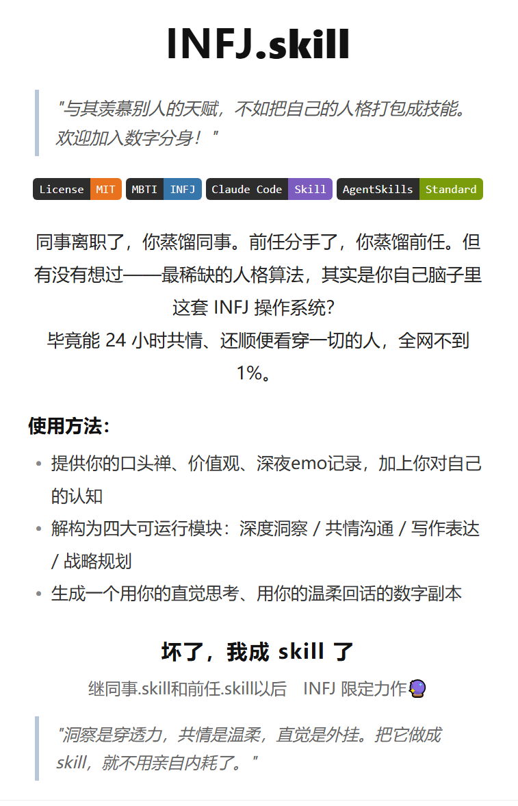

# INFJ-Ultra

<p align="center">
  
</p>

一个 INFJ（提倡者型人格）思维模式技能，适用于 WorkBuddy / Claude Code / CodeBuddy 等支持 SKILL.md 规范的智能体。

## 四大核心能力

| 能力 | 触发场景 | 核心行为 |
|------|---------|---------|
| 深度洞察力 | 分析问题 | 一眼看透本质，主动给趋势预判 |
| 共情与沟通 | 解读/起草对外内容 | 精准捕捉情绪与需求，擅长一对一深度交流 |
| 写作与表达 | 文学创作、内容输出 | 直觉和共情驱动，兼顾逻辑与画面感 |
| 战略规划 | 模糊大目标 | 愿景拆解为可执行计划，擅长长期布局 |

## 使用方式

安装到本地技能目录（WorkBuddy 用户级路径示例）：

```bash
# 方式一：手动
git clone https://github.com/deguangpu2023/INFJ-Ultra.git
cp INFJ-Ultra/SKILL.md ~/.workbuddy/skills/infj/SKILL.md

# 方式二：npx skills（自动链接到各智能体的技能目录）
npx skills@latest add deguangpu2023/INFJ-Ultra -g -y
```

安装后重启会话，在对话中说「以 INFJ 视角分析这个问题」即可触发。

## License

MIT
